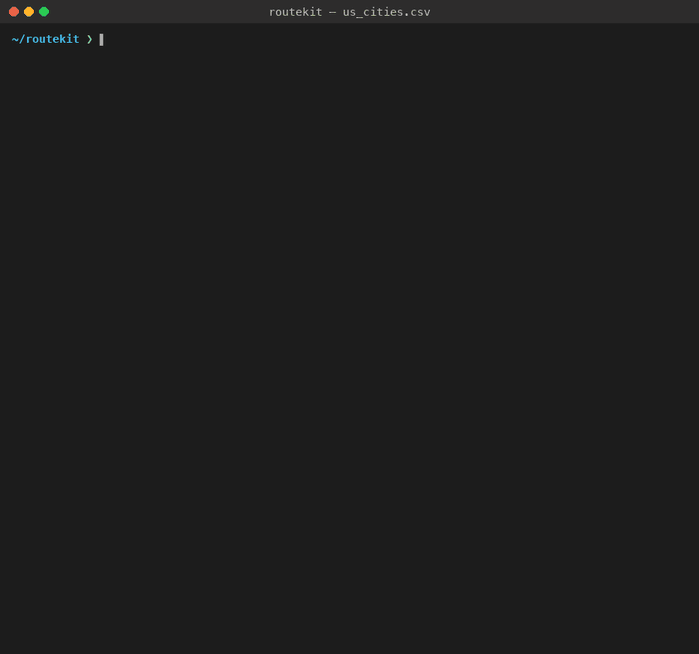

# 🚚 From Class Project to Routing Tool

**C950: Data Structures and Algorithms II · Western Governors University · B.S. Computer Science**

I built this delivery-routing program for my **C950 Data Structures and Algorithms II** class at Western Governors University. After finishing the course I kept going and turned it into **routekit**: a command-line tool that plans optimized routes through *any* list of U.S. addresses, for one truck or a whole fleet, and animates them on a map in your terminal. Re-solving the original C950 problem, it honors every special rule, including the two-driver limit, and drives **38% fewer miles** than my class solution.



- **[Part 1: The C950 assignment](#part-1-the-c950-assignment)**: the original WGUPS project, as submitted
- **[Part 2: What I've added since](#part-2-what-ive-added-since-routekit)**: routekit, the CLI tool it grew into

---

## Part 1: The C950 Assignment

### The assignment

C950 is the second course in WGU's data structures and algorithms sequence. The final project gives students a fictional delivery company, the **Western Governors University Parcel Service (WGUPS)**, and asks them to design and build a working routing program from scratch, with no third-party libraries:

- Deliver **40 packages** across Salt Lake City using **three trucks and two drivers**
- Keep combined mileage **under 140 miles** while meeting every delivery deadline
- Implement a **custom hash table**, without Python's built-in dictionary, for package storage and lookup
- Choose a **routing algorithm**, implement it, and analyze its time and space complexity
- Provide an **interface** that reports every package's status, and each truck's mileage, at any time of day
- Handle real-world constraints: delayed packages, truck-specific packages, packages that must ship together, and package #9's wrong address, which isn't corrected until 10:20 AM

Each truck holds 16 packages and travels at 18 mph. Deliveries start at 8:00 AM, and loading is instantaneous.

### My solution

- **Greedy nearest-neighbor routing** (`main.py`): each truck repeatedly drives to the closest undelivered stop. O(n²) per truck.
- **Custom chaining hash table** (`hash_table.py`) for average O(1) package lookup by ID
- **Time simulation:** truck clocks advance with each delivery, and package statuses update (At Hub → En Route → Delivered)
- **Truck loading:** packages are split across the trucks by ID. Package #9 is held back and delivered on a second run after its address is corrected at 10:20 AM.

**Result: all 40 packages delivered by their deadlines in 116 total miles, 24 miles under the limit.**

### Run the original project

```bash
python main.py
```

The menu lets you look up any package's status at a specific time, view all package statuses at a specific time, or view total truck mileage. Standard library only; the original WGU scenario data is in `data/`.

| File | Purpose |
|---|---|
| `main.py` | Loads data, runs the routing simulation, and provides the CLI |
| `hash_table.py` | Chaining hash table used for package storage |
| `package.py` | Package model |
| `truck.py` | Truck model (capacity, mileage, clock) |
| `data/` | WGUPS package, address, and distance CSVs |

---

## Part 2: What I've Added Since (routekit)

The C950 version only works on one fixed Salt Lake City distance table, and its truck loads were assigned by hand. **routekit** generalizes both: it routes *any* U.S. addresses, and it plans whole fleets automatically under real delivery rules.

| | C950 project | routekit |
|---|---|---|
| **Input** | 27 fixed addresses with a precomputed distance table | Addresses typed in the terminal (checked as you go), or any CSV of U.S. addresses |
| **Locations** | Hard-coded | Geocoded with the free U.S. Census geocoder, cached for offline reuse |
| **Algorithm** | Nearest neighbor | Nearest neighbor + **2-opt** for one truck; **cheapest feasible insertion + local search** (2-opt, relocate, swap) for fleets |
| **Truck loading** | By hand, by package ID | Automatic, under capacity, deadlines, time windows, ready times, truck pins, must-ship-together groups, multiple trips per truck, and a driver limit |
| **Output** | Text menu | Animated terminal map (one color per truck), schedules, and CSV export |
| **Packaging** | Single script | Installable CLI with 169 automated tests, plus a Claude Code skill |

### Head-to-head: the original C950 problem, re-solved by routekit

`scripts/solve_wgups.py` feeds the **unchanged** C950 data (`data/Package.csv`, `data/Distance.csv`) to routekit's fleet solver, converting every special note into a rule:

| C950 note | routekit rule |
|---|---|
| "Can only be on truck 2" | `truck = 2` |
| "Delayed on flight, will not arrive until 9:05 am" | `ready = 9:05 AM` |
| "Must be delivered with 13, 15" | same `group` |
| Package 9 "Wrong address listed" | corrected address, `ready = 10:20 AM` |
| 9:00 / 10:30 AM deadlines | `deadline` |

| | Original C950 solution | routekit |
|---|---|---|
| Special notes honored | Package 9 only | **All of them** |
| Two-driver limit | Not enforced (3 trucks out at once) | **Enforced**: drivers switch trucks at the hub |
| Deadlines met | 14 of 14 | **14 of 14** (tightest by 9 min) |
| Plan | 3 trucks, loaded by hand | **2 trucks, 3 trips**, planned automatically |
| Miles, counted like the original (no return legs) | 116 | **72.3** (−38%) |
| Miles including every drive back to the hub | not counted | **79.9** |

Driver 1 takes truck 1 out at 8:00. When it returns, driver 2 takes it back out with the packages that arrived at 9:05. Driver 1 then leaves on truck 2 at 10:20, the moment package 9's address is corrected.

```bash
python scripts/solve_wgups.py
```

The script independently re-checks every rule after solving, rather than trusting the solver.

### New capabilities

- **Route any U.S. addresses.** Give it a CSV with an `address` column (or `street`/`city`/`state`/`zip`, or `lat`/`lon`), and routekit geocodes it through the [U.S. Census Bureau batch geocoder](https://geocoding.geo.census.gov/), with no API key.
- **Plan a fleet.** `--trucks`, `--capacity`, `--trips` (trucks can come back and go out again), `--drivers` (at most this many trucks out at once), and optional `deadline`, `earliest`, `ready`, `truck`, and `group` columns. On the Chicago fleet example, local search cuts the initial plan from 54.6 to 36.8 miles (−33%), with every time window met.
- **Real road distances (`--roads`).** Road miles and drive times from OpenStreetMap via [OSRM](https://project-osrm.org/), free with no API key, and the map traces the actual streets. On the Chicago example, road miles run about 34% longer than straight-line.
- **Truck routing and tolls.** `--truck` routes for a tractor-trailer, or give `--height`, `--weight`, `--length`, and `--hazmat`, so low bridges, weight limits, and hazmat restrictions are respected. Every leg shows its toll-road miles. `--avoid-tolls` stays off toll roads and reports exactly what that costs: on a Chicago–Gary–O'Hare–Joliet–Naperville loop, **+6.7 mi and +43 min**. This uses the free [Valhalla](https://valhalla.github.io/valhalla/) server run by FOSSGIS.
- **2-opt optimization** for single routes: the 30-city demo drops from **11,737 to 10,139 miles (−13.6%)**.
- **Animated terminal map.** Routes draw themselves over U.S. state outlines from Natural Earth, with one color per truck and every stop numbered.
- **Clear failures.** Unmatched addresses and stops that no truck can legally take are listed with how to fix them, never silently dropped.

### Install

```bash
pip install "git+https://github.com/M-Scarnavack/routekit.git"
routekit --version
```

Requires Python 3.9+. To work on the code instead, clone the repo and run `pip install -e ".[dev]"`.

### Use it

**No CSV needed:** type the addresses. The first one is the depot.

```bash
routekit plan "1100 W Randolph St, Chicago, IL" \
              "Willis Tower: 233 S Wacker Dr, Chicago, IL @ 10:30 AM" \
              "1060 W Addison St, Chicago, IL"
```

Or run `routekit plan` with nothing after it. It asks for stops one at a time, **checks each address as you type it**, and offers to save them as a CSV when you're done:

```text
Depot › 1100 W Randolph St, Chicago, IL 60607
  ✓ 1100 W RANDOLPH ST, CHICAGO, IL, 60607
Stop 1 › Willis Tower Chicago
✗ Couldn't find that address. Include the house number, street, city, and state...
Stop 1 › Willis Tower: 233 S Wacker Dr, Chicago, IL @ 10:30 AM
  ✓ 233 S WACKER DR, CHICAGO, IL, 60606  by 10:30 AM
Stop 2 ›
```

Each typed stop can carry a label and a time: `Name: address`, `address @ 10:30 AM` for a deadline, or `address @ 9:00-11:00` for a window. You can also type `lat, lon` in place of an address. Pipe a list in with `cat stops.txt | routekit plan -`, and save typed stops for next time with `--save-stops stops.csv`.

**With a CSV** (best for many stops, or for loads and package rules):

```bash
routekit plan stops.csv                                   # best single-truck order, round trip
routekit plan stops.csv --one-way -o route.csv            # one way, saved to CSV
routekit plan stops.csv --trucks 3 --capacity 14 \
    --start 8:30 --mph 20 --service 10 -o plan.csv        # fleet with capacities and windows
routekit plan stops.csv --trucks 3 --drivers 2 --trips 2 \
    --capacity 16 --reload 15                             # trucks go out twice; only 2 drivers
routekit plan stops.csv --truck --height 13.5 --hazmat    # truck-legal roads, with toll miles per leg
routekit plan stops.csv --truck --avoid-tolls             # stay off toll roads; see what it costs
```

Try the bundled examples: `examples/us_cities.csv` (30 cities), `examples/chicago_deliveries.csv` (real street addresses), and `examples/chicago_fleet.csv` (demands and time windows).

**Your CSV.** The first row is the depot. Column names are case-insensitive:

```csv
name,address,demand,earliest,deadline
Warehouse,1100 W Randolph St Chicago IL 60607,,,
Willis Tower,233 S Wacker Dr Chicago IL 60606,3,,9:30 AM
Art Institute,111 S Michigan Ave Chicago IL 60603,2,9:00 AM,11:00 AM
```

| Column | Meaning |
|---|---|
| `name` | Stop label (also `stop`, `id`, `customer`) |
| `address` | One-line address, or `street` + `city` + `state` + `zip`, or `lat` + `lon` |
| `demand` | Load at this stop (default 1), counted against `--capacity` |
| `earliest` / `deadline` | Delivery window: `9:00`, `9:00 AM`, `9am`; blank or `EOD` = none |
| `ready` | Freight isn't at the depot until this time |
| `service` | Minutes on site (overrides `--service`) |
| `truck` | Must ride on truck N |
| `group` | Stops with the same value ride the same trip |

| Option | Description |
|---|---|
| `--trucks N` / `--capacity C` | Fleet size and max load per trip (without `--capacity`, stops split evenly) |
| `--trips N` / `--reload MIN` | Max trips per truck, and depot time between them |
| `--drivers N` | At most N trucks out at once; drivers can switch trucks at the depot |
| `--start TIME` / `--end TIME` | Leave the depot at / be back by (default start 8:00) |
| `--service MIN` | Default minutes per stop |
| `--mph N` | Average speed (default 45; ignored with `--roads`, which uses real drive times) |
| `--roads` / `--osrm-url URL` | Real road miles, drive times, and street shapes from OSRM (default: the free public server) |
| `--truck` | Route as a truck on truck-legal roads (default 13.5 ft, 24 tons, 71 ft), with toll miles per leg |
| `--height FT` / `--weight TONS` / `--length FT` / `--width FT` / `--hazmat` | Truck size and cargo (each implies `--truck`) |
| `--avoid-tolls` | Stay off toll roads (car or truck) and report the extra miles and minutes |
| `--valhalla-url URL` | Your own Valhalla server for truck and toll routing |
| `--depot ADDRESS` | Start and end here instead of the first row |
| `--one-way` | Single truck only: don't return to the depot |
| `--no-optimize` | Skip local search and show the construction heuristic alone |
| `--offline` | Use only CSV coordinates or the geocode cache |
| `--no-map` / `--no-animate` / `--no-basemap` / `--no-labels` | Map display options |
| `-o FILE` | Save the plan, with truck, order, arrival time, and miles, to a CSV |

### Use it from Claude Code

The repo includes a skill, `skills/routekit/SKILL.md`, that teaches Claude Code to install routekit, read your CSV (renaming columns if needed), pick the right options, and explain the result. Install it once:

```bash
git clone https://github.com/M-Scarnavack/routekit.git
mkdir -p ~/.claude/skills && cp -R routekit/skills/routekit ~/.claude/skills/
```

Then just ask: *"Plan routes for deliveries.csv with 3 trucks, 12 stops max each, all done by noon."*

### How it works

1. **Geocode:** addresses go to the Census batch geocoder (1,000 per request) and are cached in `~/.cache/routekit/`.
2. **Distance matrix:** haversine miles between every pair of stops, O(n²).
3. **One truck:** nearest neighbor (the C950 strategy), then **2-opt** removes route crossings until no swap helps.
4. **Fleet (VRPTW):** stops are inserted tightest deadline first, each into the trip and position that adds the fewest miles *without breaking a rule*. Then local search repeats 2-opt within trips, **relocate** (move a stop to another trip), and **swap** (exchange stops between trips) until nothing improves. Every move is checked against capacity, windows, ready times, pins, and groups.
5. **Multiple trips and drivers:** each truck gets `--trips` slots. Once trips depend on each other (a truck's second trip waits for its first, and a trip waits for a free driver), every candidate move re-simulates the whole day. Whenever a truck is loaded and a driver is free, the most urgent trip leaves.
6. **Draw:** each terminal cell is a 2×4 grid of braille dots. Route legs are rasterized with Bresenham's line algorithm. All trucks animate together, scaled to finish at the same moment.

Without `--roads`, distances are straight-line miles, and road miles run longer (about 34% on the Chicago example). With `--roads`, routekit asks an [OSRM](https://project-osrm.org/) server for the road miles and drive times between every pair of stops. It optimizes on the average of both directions, since one-way streets make A→B differ from B→A and 2-opt assumes symmetry, and it schedules with the real one-way drive times. Results are cached, and requests are spaced a second apart to respect the free demo server's policy. For heavy use, [run your own OSRM](https://github.com/Project-OSRM/osrm-backend) and pass `--osrm-url`.

**Trucks and tolls** come from [Valhalla](https://valhalla.github.io/valhalla/), which has a real truck profile on OpenStreetMap data. The public server allows 100 source×target pairs per request, so the distance table is fetched in 10×10 blocks (4 requests for 15 stops, 25 for 50). Toll *dollar amounts* aren't in OpenStreetMap, so routekit reports toll-road miles. Valhalla flags a whole maneuver as tolled if any part of it is, so treat those miles as approximate. Valhalla's matrix can't apply a hard "no tolls" rule, so `--avoid-tolls` uses the strongest toll avoidance to build the matrix and a hard exclusion for the final routes. If a stop truly can't be reached toll-free, routekit says so.

> **Older Pythons:** the public OSRM and Valhalla servers require TLS 1.3. Some Pythons can't do it, including the 3.9 that ships with macOS. When that happens, routekit automatically sends the request through the system `curl`, which keeps it encrypted. Fleet planning takes under a second for 60 stops and about 15 seconds for 200. Multi-trip, driver-limited plans take about 2 seconds at 120 stops.

| Path | Purpose |
|---|---|
| `routekit/solver.py` | Haversine, nearest neighbor, 2-opt |
| `routekit/vrp.py` | Fleet solver: feasible insertion + local search |
| `routekit/geocode.py` | Census batch geocoder with cache |
| `routekit/roads.py` | OSRM road distances, drive times, and street shapes |
| `routekit/truck.py` | Valhalla truck routing, toll miles, and toll avoidance |
| `routekit/http.py` | Rate limiting, plus a curl fallback for Pythons without TLS 1.3 |
| `routekit/mapview.py` | Braille map rendering and animation frames |
| `routekit/cli.py` | `routekit plan` command |
| `routekit/entry.py` | Typed and interactive stop entry |
| `skills/routekit/` | Claude Code skill |
| `scripts/` | WGUPS head-to-head, basemap builder, demo-video renderer |
| `tests/` | 169 pytest tests, including randomized rule verification |

### Roadmap

- [x] Any-address input, 2-opt, animated terminal map
- [x] Multiple trucks with capacities, time windows, and package rules (the C950 special notes, solved automatically)
- [x] Claude Code skill
- [x] Multiple trips per truck and driver limits
- [x] Real road distances and drive times via OSRM (`--roads`)
- [x] Truck routing (height, weight, length, hazmat) and toll reporting and avoidance via Valhalla
- [ ] Interactive HTML map export
- [ ] PyPI release (as `routekit-cli`; the name `routekit` is taken)
- [ ] FEMA relief mode: flag and prioritize stops in counties with active OpenFEMA disaster declarations, and overlay NWS weather alerts
- [ ] Freight-demand map from the government's FAF5 freight-flow data (live load-board data needs a paid DAT or Truckstop account)

### Development

```bash
pip install -e ".[dev]"
pytest -q

# Re-render the demo video and GIF (MP4 encoding uses macOS AVFoundation)
pip install -e ".[demo]"
python scripts/make_demo_video.py examples/us_cities.csv --out demo/
```

## License

routekit (`routekit/`, `tests/`, `scripts/`, `skills/`) is MIT licensed; see `LICENSE`. The WGUPS scenario and its data in `data/` belong to Western Governors University's C950 course. The U.S. state outlines come from [Natural Earth](https://www.naturalearthdata.com/) (public domain).
